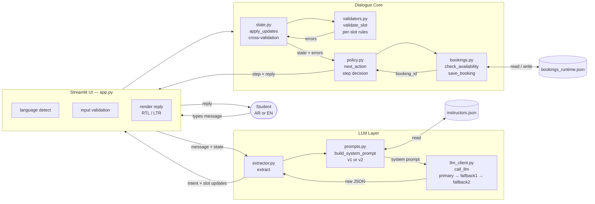

# Mawid — Architecture

## Component Diagram

## Data Flow (one turn)

1. **User types a message** in the Streamlit chat input.
2. **`app.py`** detects the language (Arabic letters present → AR, else EN), validates input length, and sets `state["language"]` and `state["_today"]`.
3. **`extractor.extract()`** builds a system prompt (`prompts.build_system_prompt`, v2 in production) and calls **`llm_client.call_llm()`**.
4. **`llm_client`** tries the primary model (Gemini 3.8-flash) with retry logic. On 429 it immediately switches to the fallback chain (3.5-flash-lite → 3.1-flash-lite) and blocks the primary for 10 minutes. Returns the raw text response.
5. **`extractor`** strips JSON fences, parses the response, and returns `{"intent": ..., "updates": {...}}`.
6. **`state.apply_updates()`** validates each changed slot via **`validators.validate_slot()`**, then cross-validates dependent slots (instructor change → re-check date; date change → re-check time). Returns the new state and any error strings.
7. **`policy.next_action()`** decides the next dialogue step (ask, reask, suggest, confirm, booked, cancelled, redirect). For `confirm` intent with all slots filled, it calls **`bookings.check_availability()`**. For `booked` step, it calls **`bookings.save_booking()`** which writes to `bookings_runtime.json` and returns a booking ID.
8. **`app.py`** renders the reply with `_render_reply()`: AR messages go in an RTL HTML div with dates/times/IDs wrapped in `` to prevent reversal; EN messages use standard `st.markdown`.

## Key Design Decision

**The model understands; the code decides.**  
The LLM's only job is to extract *intent* and *slot values* from free text — including resolving relative dates using today's date provided in the prompt. All validation, availability checking, state management, and next-step logic are handled by deterministic Python code. This prevents the LLM from making booking decisions or producing inconsistent states, and makes the system testable without LLM calls for the core logic (see `tests/test_phase2a.py`).
