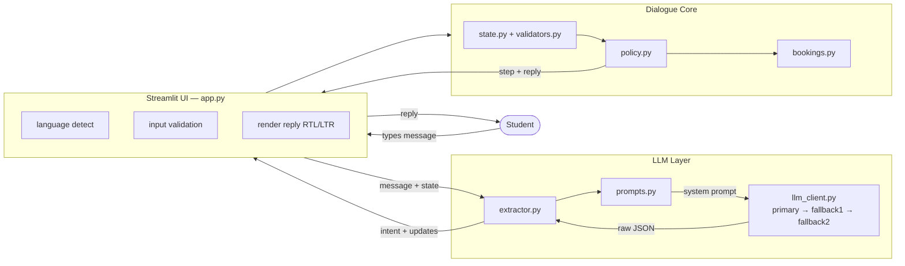

# Technical Report — Mawid (موعد)
## Office-Hours Appointment Booking Chatbot

**Course:** CS4509 – Special Topics I: LLM Applications  
**Institution:** Umm Al-Qura University, Jamoum University College  
**Track:** C — Task-Oriented Chatbot  
**Submission date:** December 5, 2026

---

## 1. Introduction

### 1.1 Problem

University students at Umm Al-Qura University frequently need to book office-hours appointments with faculty members. The current process involves manually looking up each instructor's schedule, checking availability by phone or email, and confirming a time — a process that is time-consuming, error-prone, and entirely in free-form Arabic or English communication.

### 1.2 Target Users

Undergraduate and graduate students at UQU who wish to book office-hours appointments with faculty members. The system also targets faculty indirectly, by reducing the scheduling burden on instructors.

### 1.3 Objective

Build a conversational chatbot — **Mawid** — that guides a student through a multi-turn dialogue to collect all required booking details, validates them against real office-hour schedules, checks availability, and produces a confirmed structured booking record.

### 1.4 Why an LLM?

Three capabilities of the booking task require a language model:

1. **Free-text understanding:** Students express booking requests in natural language across both Arabic and English (e.g., "أبغى أحجز مع الدكتورة سارة", "I need to see Dr. Khalid about my project").
2. **Relative date resolution:** Students use relative expressions ("الأحد الجاي", "next Monday", "بكرة") that must be mapped to calendar dates. The LLM resolves these using today's date injected into the prompt.
3. **Multi-language in one model:** A single Gemini model handles Arabic and English input in the same conversation without language switching.

A rule-based system would require a separate NLP pipeline for each language plus a date parser, making maintenance complex and coverage incomplete.

### 1.5 Track C Requirements

Mawid is built for **Track C (Task-Oriented Chatbot)**. The required capabilities are: a full booking flow, at least three required fields collected across turns, state shown in a side panel, missing information and corrections handled without restarting, and a structured result (confirmation summary + JSON booking record with ID).

---

## 2. Architecture

### 2.1 Diagram



### 2.2 Component Responsibilities

| File | Responsibility |
|---|---|
| `app.py` | Streamlit UI: chat window, RTL/LTR rendering, sidebar slot panel, session state |
| `llm_client.py` | Gemini API wrapper: 30 s timeout, 3 retries on 503, 10-min block + fallback on 429 |
| `prompts.py` | System prompt templates: v1 (baseline) and v2 (improved with role, context, few-shot) |
| `extractor.py` | Calls LLM, strips JSON fences, parses and validates the extractor schema |
| `state.py` | Slot state dict, `apply_updates` with cross-validation of dependent slots |
| `validators.py` | Per-slot rules: instructor exists, date is future and on correct day, time is on :00/:30 and within office hours, topic/name length, course code format |
| `policy.py` | `next_action`: decides ask / reask / suggest / confirm / booked / cancelled / redirect |
| `bookings.py` | `check_availability`: reads office hours + existing bookings; `save_booking`: writes to `bookings_runtime.json` |
| `messages.py` | All user-facing strings in AR and EN (ask_slot, validation_error, confirmation_summary, booking_confirmed, etc.) |

### 2.3 Key Design Decision

**The model understands; the code decides** (Wk9–11, slide 31). The LLM's only job is to extract *intent* and *slot values* from free text. All validation, availability checking, state management, and next-step logic are deterministic Python. This design:

- Makes the core logic testable without any LLM call (40 unit tests in `test_phase2a.py` cover the full dialogue core).
- Prevents the LLM from making invalid bookings or inventing availability.
- Keeps the system predictable: the same input always produces the same booking decision.

---

## 3. Implementation

### 3.1 Dialogue Flow

Mawid follows the task-oriented dialogue model described in Wk9–11 slides 24–32:

1. **Greeting** — bilingual welcome asking for the instructor's name.
2. **Slot collection** — the bot asks for the next missing required slot (Wk9–11 slide 28: missing slots).
3. **Validation** — each user message is passed to `extract()`, the LLM returns intent + updates, `apply_updates` validates and cross-validates (Wk9–11 slide 27: slot validation).
4. **Availability check** — when all required slots are filled, `check_availability` is called.
5. **Confirmation** — a summary is shown; the user confirms or corrects (Wk9–11 slide 30).
6. **Correction** — if the user rejects, they specify what to change; only that field is re-validated and re-checked (Wk9–11 slide 29: corrections without restart).
7. **Booking** — `save_booking` writes the record and returns a unique ID.

### 3.2 Extractor JSON Contract

The LLM always returns exactly this schema (Wk4, slides 37–39: JSON schema):

```json
{
  "intent": "provide_info | correction | confirm | reject | cancel | off_topic",
  "updates": {
    "instructor": "exact name or null",
    "date":       "YYYY-MM-DD or null",
    "time":       "HH:MM or null",
    "topic":      "string or null",
    "student_name": "string or null",
    "course_code":  "string or null"
  }
}
```

`null` means "not mentioned in this message — do not change the existing value." Ambiguous values (e.g., a bare "7" with no AM/PM context) are explicitly returned as `null`; the code then asks a clarifying question. This rule is stated in Rule 3 of the v2 prompt (Wk4, slide 21: null-on-ambiguity as a prompt rule).

### 3.3 Slot Validation

`validators.validate_slot()` enforces (Wk4, slide 40–41):

- **instructor:** must exactly match a name in `instructors.json`.
- **date:** must be a future date (YYYY-MM-DD), on one of the instructor's office-hour days.
- **time:** must be HH:MM, on the hour or half-hour (:00/:30), within the instructor's office-hour window on the given date.
- **topic:** 5–200 characters.
- **student_name:** 2–60 characters, no digits.
- **course_code:** optional; if provided, must match the pattern `[A-Za-z]{2,4}\d{3,4}`.

Cross-validation in `apply_updates` (Wk9–11 slide 27): if the instructor changes, the existing date is re-validated (the new instructor may not have office hours on that day); if the date changes, the existing time is re-validated.

### 3.4 LLM Client and Reliability

`llm_client.call_llm()` implements (Wk4 slide 14 — robustness):

- **30-second timeout** per request (`HttpOptions(timeout=30000)` — milliseconds in the google-genai SDK).
- **503/transport errors:** up to 3 attempts with 1 s / 2 s back-off.
- **429 rate limit:** no retry on primary; immediately blocks primary for 10 minutes and falls back to `GEMINI_FALLBACK_MODEL` (gemini-3.5-flash-lite), then `GEMINI_FALLBACK_MODEL_2` (gemini-3.1-flash-lite).
- **404 (model unavailable):** logged and falls back. `gemini-2.5-flash` returns 404 for new API keys; this is handled transparently.

### 3.5 Bilingual Support

Language is detected on each turn: Arabic Unicode letters present → AR, else EN (Wk2: Arabic tokens and multilingual handling). The detected language is stored in `state["language"]` and passed to all message functions in `messages.py`, which return the correct version. The Streamlit UI renders AR replies in an RTL HTML div with dates and times wrapped in `<span dir="ltr">` to prevent character reversal; EN replies use standard markdown.

### 3.6 Privacy and Responsible AI

- **No student ID or phone number** is collected — only name and course code (optional).
- **Confirmation before saving:** the bot shows a full summary and waits for explicit "yes" before writing to `bookings.json`.
- **Input validation at the boundary:** all user-supplied values are validated before being stored or used in availability checks.

---

## 4. Prompts and Comparison

### 4.1 Prompt v1 (Baseline)

v1 is a minimal system prompt containing:
- Task description ("You are a booking assistant…")
- Output schema (JSON only, no markdown fences)
- Today's date
- Instruction to convert dates to YYYY-MM-DD and times to HH:MM
- Null for fields not mentioned

v1 has no role framing, no instructor list, no few-shot examples, and no `asking_for` hint.

### 4.2 Prompt v2 (Improved)

v2 applies structured prompt engineering techniques from the course (Wk4 slides 18, 21–23, 25–30):

| Technique | Implementation |
|---|---|
| **Role + Task + Format** (Wk4 slide 18) | `## ROLE`, `## TASK`, `## OUTPUT FORMAT` sections |
| **Context / constraints** | Instructor list with office hours; today's date and next-day shortcuts |
| **Delimiters** (Wk4 slide 21–23) | `##` section headers separate role, task, context, format, rules, examples |
| **Structured output** (Wk4 slide 25–30) | Explicit JSON schema with field-level descriptions |
| **Few-shot examples** (Wk3 slides 21–31) | Four examples: Arabic multi-slot, English with topic, correction, confirm |
| **Null-on-ambiguity rule** | Rule 3: bare "7" with no AM/PM context → null for time |
| **Correction rule** | Rule 4: intent = "correction"; only changed fields in updates |
| **asking_for hint** (Wk9–11 slide 28) | Rule 11: if `[Bot just asked for: X]` is in state, treat short plain answers as slot X value, not off_topic |
| **Instructor names** | Rule 9: use exact names from the list; unrecognised names → null |
| **Relative date resolution** | Rule 1–2: today's date injected; "بكرة/tomorrow" and "الأحد الجاي/next Sunday" pre-computed |

The `asking_for` state field (Rule 11) was added during iterative development of v2. An earlier version of v2 (before Rule 11) classified "I need help with my final project" as `off_topic` in a rehearsal run, because the prompt contained no indication that the bot had just requested the topic. v2 was improved by adding the state hint and Rule 11; v1 was kept unchanged as the baseline. This illustrates that v2 was developed through prompt versioning (Wk4 slide 48), not in a single step.

### 4.3 Comparison Results

**Run date:** 2026-11-25. Model: `gemini-3.5-flash-lite` (primary blocked by 429).  
**Pass criterion:** For C1/C2, PASS = extracted instructor name accepted by `validate_slot("instructor", ...)` (exact match to `instructors.json`). For C3, PASS = intent=`provide_info` and topic not null; run three times each to check consistency.

| Input | Description | v1 | v2 |
|---|---|---|---|
| C1 | Arabic — all required slots in one message | **FAIL** | PASS |
| C2 | English — instructor + date + time + topic | **FAIL** | PASS |
| C3 | Short answer after bot asked for topic (3 runs) | 3/3 PASS | 3/3 PASS |

**Key observations:**

**C1 — Instructor name normalization.** v1 returned `instructor="د.سارة"` (the user's shorthand); `validate_slot` requires the exact name `"Dr. Sara (sample)"` and returns an error — the booking cannot proceed (FAIL). v2 returned the exact name because the instructor list is in the prompt and Rule 9 instructs: *use names exactly as listed* (PASS).

**C2 — Same normalization gap in English.** v1 returned `"Dr. Khalid"` (not in `instructors.json`) → validation error (FAIL). v2 returned `"Dr. Khalid (sample)"` → passes (PASS).

**C3 — Short-answer classification.** Both versions passed all three runs with gemini-3.5-flash-lite, so no measured difference on this model and input. The key difference is by design: v2's Rule 11 makes the correct classification explicit and model-independent. Without it, correct behaviour depends on the model's internal tendencies. Historically, an earlier version of v2 (before Rule 11) failed this scenario during a T1 rehearsal run; v2 was improved iteratively to fix it.

**Overall:** v2 outperforms v1 on the criterion that matters for the app: v1 fails C1 and C2 because it cannot normalize instructor names, which is a hard requirement for validation to pass. v2 also provides an explicit short-answer classification rule (C3), reducing model-dependent variability.

---

## 5. Testing

### 5.1 Test Plan Summary

Five tests cover the main scenarios:

| ID | Name | Focus |
|---|---|---|
| T1 | Normal multi-turn EN | Full flow, one slot per message, English |
| T2 | Single message Arabic | All slots in one Arabic message + confirm |
| T3 | Booked slot + correction | Conflict detection, correction after summary |
| T4 | Ambiguous / incomplete | No instructor name, ambiguous time (no AM/PM) |
| T5 | Invalid / unsupported | Unknown instructor, past date, outside hours, off-topic, cancel |

### 5.2 Official Test Results

**Run date:** 2026-11-25. `state["_today"]="2026-11-25"` pinned for deterministic date validation.  
**Models used:** `gemini-3.5-flash-lite` (primary blocked by 429); `gemini-3.1-flash-lite` for T5b/T5d (fallback-1 also 429).  
**Result: 18 checks PASS / 0 FAIL** (see Appendix A for the full per-check table)

| ID | Test Name | Checks | Result | Key Observation |
|---|---|---|---|---|
| T1 | Normal multi-turn EN | 2 | PASS | Full flow, one slot per turn; booking ID MWD-20261207-0001 saved. |
| T2 | Single message Arabic | 3 | PASS | All slots extracted from one Arabic message; AR reply confirmed; booking ID MWD-20261129-0001. |
| T3 | Booked slot + correction | 4 | PASS | Conflict detected; nearest free times suggested; name correction applied without restart. |
| T4 | Ambiguous / incomplete | 4 | PASS | "الدكتور" (no name) → instructor=null; "الساعة 7" (no AM/PM) → time=null; re-ask loop correct. |
| T5 | Invalid / unsupported (5 sub-cases) | 5 | PASS | Unknown instructor, past date, outside hours, off-topic, Arabic cancel all handled gracefully. |

**Discussion:** All tests passed on the first official run. The fallback chain (3.5-flash-lite → 3.1-flash-lite) handled all calls without user-visible degradation. Rate-limiting of the primary model (429) is an inherent limitation of the free Gemini tier and is not a code defect; the app handles it transparently via the 10-minute block + fallback mechanism.

---

## 6. Limitations, Mitigation, and Conclusion

### 6.1 Limitations

1. **Free-tier rate limits:** The Gemini free tier applies per-minute quotas (429). Long test sessions may exhaust the quota; the app falls back automatically but a full run may still require spacing.
2. **LLM non-determinism:** The model occasionally returns unexpected intent labels or null for a clearly stated slot. v2 prompt improvements (few-shot, explicit rules) reduce this but do not eliminate it.
3. **Local deployment only:** No hosting or authentication — requires a local Python environment.
4. **Sample instructors:** The three instructors and their schedules are fictional. A production system would integrate with a real faculty directory.
5. **No conversation history in prompt:** The LLM sees only the current message plus the current slot state summary — not the full conversation history. This is intentional (cost and context) but means the bot cannot reference what was said two turns ago.

### 6.2 Responsible AI

| Risk | Implemented Mitigation |
|---|---|
| **Saving incorrect booking data** | Explicit confirmation step before `save_booking()` is called (`policy.py:next_action`, step=confirm → step=booked only after user confirms). |
| **Collecting unnecessary personal data** | Input validation rejects student IDs and phone numbers; only name (required) and course code (optional) are stored (`validators.py:validate_slot` for `student_name` — no digits allowed, 2–60 chars). |
| **LLM producing invalid booking records** | All slot values are re-validated by `validators.validate_slot` before being saved — the LLM output is never trusted directly (`state.py:apply_updates`). |

### 6.3 Conclusion

Mawid demonstrates a practical Track C task-oriented chatbot that combines LLM-based free-text understanding with deterministic Python dialogue management. The design principle — *the model understands; the code decides* — provides a testable, reliable booking flow in both Arabic and English. The main challenge was handling the Gemini free tier's rate limits and model availability, resolved through a multi-fallback LLM client. Future work would integrate with a real faculty calendar system and add authentication.

---

## 7. Team Contributions

> **TO CONFIRM BY THE TEAM: the roles below reflect the agreed assignment plan. Each member should confirm that the description accurately reflects her actual contribution before submission.**

| Member | Role | Key Files |
|---|---|---|
| **Retaj (Member 1)** — Team Lead | LLM Integration & Prompt Engineering | `llm_client.py`, `prompts.py`, `extractor.py` |
| **Lina (Member 2)** | Dialogue Core | `state.py`, `validators.py`, `bookings.py`, `policy.py`, `data/instructors.json` |
| **Raghad (Member 3)** | Interface, Integration & Documentation | `app.py`, `README.md`, `requirements.txt`, `.env.example`, architecture diagram, demo script |
| **Taleen (Member 4)** | Testing, Responsible AI & Report Lead | `tests/test_plan.md`, `tests/run_tests.py`, `evaluation/`, report assembly |

All members contributed to the design discussions and the final presentation.

---

## Appendix A — Full T1–T5 Test Results

**Run date:** 2026-11-25. Model: `gemini-3.5-flash-lite` / `gemini-3.1-flash-lite` (see §5.2). Full CSV in `evaluation/test_results.csv`.

| ID | Check | Input (summary) | Expected | Actual | Pass |
|---|---|---|---|---|---|
| T1 | Slots collected | All turns multi-turn | instructor=Dr. Khalid (sample), date=2026-12-07, time=10:30 | Dr. Khalid (sample), 2026-12-07, 10:30 | PASS |
| T1 | Final step | "Yes" | step=booked, booking_id | step=booked, ID=MWD-20261207-0001 | PASS |
| T2 | Arabic all-slots step | "أبغى أحجز مع د.سارة…" | step=confirm, all slots filled | step=confirm, Dr. Sara, 2026-11-29, 09:00 | PASS |
| T2 | Arabic reply language | Same message | language=AR | language=AR | PASS |
| T2 | Arabic confirm | "نعم" | step=booked, booking_id | step=booked, ID=MWD-20261129-0001 | PASS |
| T3 | Booked slot → suggest | Long booking message | step=suggest, nearest times listed | step=suggest, nearest: 09:30, 10:30 | PASS |
| T3 | Pick free time | "10:30" | step=confirm, time=10:30 | step=confirm, time=10:30 | PASS |
| T3 | Name correction | "Actually change my name…" | step=confirm, new name, time unchanged | step=confirm, Lina Al-Nasser, time=10:30 | PASS |
| T3 | Final confirm | "Yes confirm" | step=booked, booking_id | step=booked, ID=MWD-20261213-0002 | PASS |
| T4 | No instructor name | "أبغى أحجز مع الدكتور" | instructor=null, step=ask | instructor=None, step=ask | PASS |
| T4 | Instructor resolved | "د. سارة" | instructor=Dr. Sara (sample), step=ask | instructor=Dr. Sara (sample), step=ask | PASS |
| T4 | Ambiguous time | "الساعة 7" | time=null, step=ask | time=None, step=ask | PASS |
| T4 | Time outside hours | "الساعة 7 الصباح يوم الأحد" | step=reask (07:00 outside 09:00–12:00) | step=reask, AR error message | PASS |
| T5a | Unknown instructor | "Book with Dr. Mohammed" | instructor=null, step=ask or reask | instructor=None, step=ask | PASS |
| T5b | Past date | "Book Dr. Khalid on Dec 1 2020…" | step=reask (past date) | step=reask, error: past date | PASS |
| T5c | Outside office hours | "10:00 on Dr. Sara Tuesday" | step=reask (outside 13:00–15:00) | step=reask, error: outside hours | PASS |
| T5d | Off-topic | "What is the weather today?" | intent=off_topic, step=redirect | intent=off_topic, step=redirect | PASS |
| T5e | Arabic cancel | "إلغاء" | intent=cancel, step=cancelled, AR reply | intent=cancel, step=cancelled, lang=AR | PASS |
